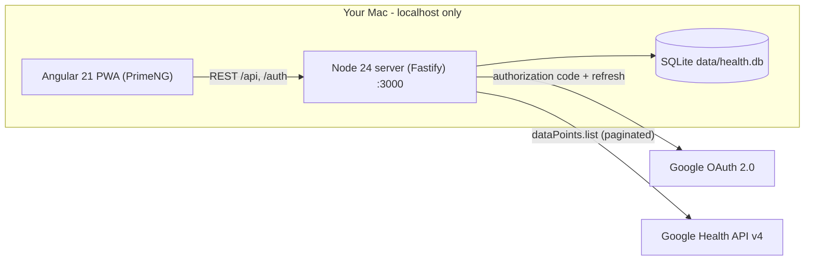
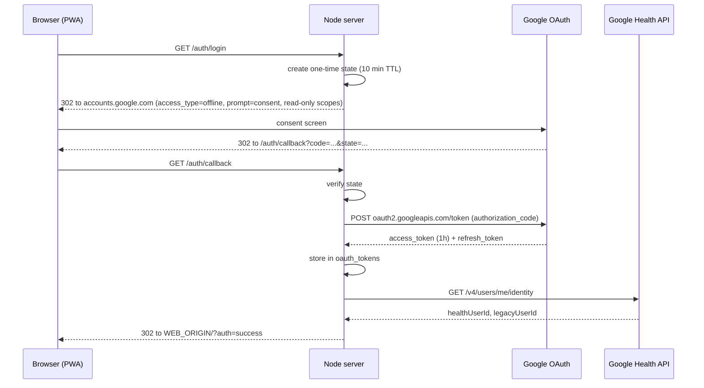
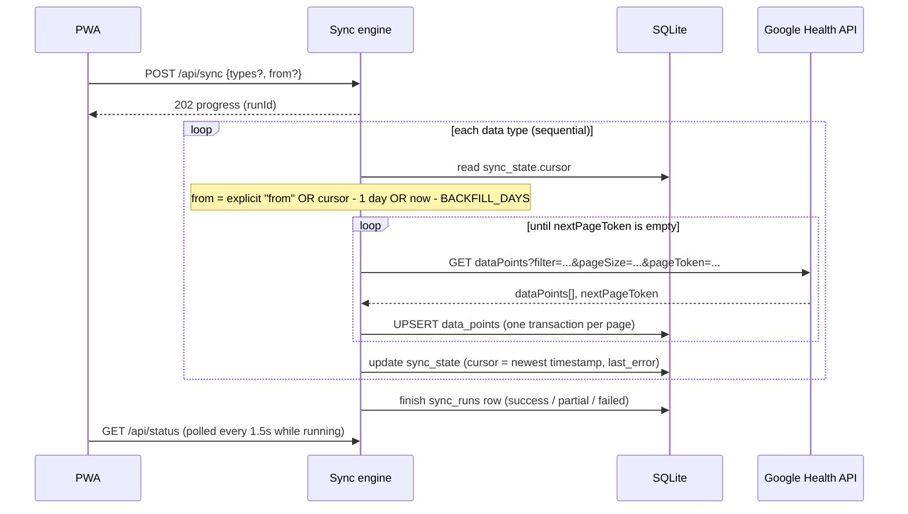

# fitbit-analyzer

Sync your personal **Fitbit Air** data from the **Google Health API** into a local SQLite database and explore it in an installable Angular 21 + PrimeNG PWA on your Mac.

This is an MVP focused on *getting the data*: connect your Google account, sync steps, heart rate, sleep, exercise and HRV / SpO2 / respiratory rate, browse the raw records and export them as CSV or JSON for your own analysis.

> **Why the Google Health API?** The legacy Fitbit Web API (`api.fitbit.com`) was turned down in September 2026. Fitbit device data is now served by the [Google Health API](https://developers.google.com/health/about) (`health.googleapis.com/v4`) using standard Google OAuth 2.0.

---

## Architecture



Two processes, one repo (npm workspaces):

| Workspace | Stack | Role |
| --- | --- | --- |
| [`server/`](server) | Node 24, TypeScript (via `tsx`), Fastify 5, built-in `node:sqlite` | OAuth, sync engine, storage, REST API, serves the built PWA |
| [`web/`](web) | Angular 21 (standalone, signals, zoneless), PrimeNG 21 (Aura), `@angular/service-worker` | UI: connect, trigger syncs, browse and export data |

The server is the only component that talks to Google. The OAuth client secret and tokens never reach the browser, and all health data stays on your machine in `data/health.db`.

### Server modules (`server/src`)

| Module | Responsibility |
| --- | --- |
| [`config.ts`](server/src/config.ts) | Loads `server/.env` (via `process.loadEnvFile`) and exposes typed settings. |
| [`db.ts`](server/src/db.ts) | Opens SQLite (WAL mode), creates the schema, and provides small repository functions for tokens, data points, sync state and sync runs. |
| [`auth.ts`](server/src/auth.ts) | `/auth/login`, `/auth/callback`, `/auth/logout`. Exchanges the code, stores tokens, calls `users/me/identity`, refreshes the 1h access token transparently, and treats `invalid_grant` as "disconnected". |
| [`dataTypes.ts`](server/src/dataTypes.ts) | Registry of synced data types: record kind, OAuth scope, page size, filter builder, timestamp extraction and stable key derivation. |
| [`healthClient.ts`](server/src/healthClient.ts) | Typed `fetch` wrapper for `GET /v4/users/me/dataTypes/{type}/dataPoints`, following `nextPageToken`, with exponential backoff on 429/5xx (honours `Retry-After`). |
| [`sync.ts`](server/src/sync.ts) | Incremental sync engine. Runs in the background, one type after another, and keeps live progress that `/api/status` exposes. |
| [`api.ts`](server/src/api.ts) | REST endpoints for the PWA: status, sync trigger, paginated data queries, CSV/JSON export. |
| [`index.ts`](server/src/index.ts) | Fastify bootstrap. Also serves `web/dist` with SPA fallback when the PWA has been built. |

### Web app (`web/src/app`)

| Part | Responsibility |
| --- | --- |
| [`core/api.service.ts`](web/src/app/core/api.service.ts) | `HttpClient` wrapper and shared types for the REST API. |
| [`pages/connect-sync`](web/src/app/pages/connect-sync) | Connection card (Connect / Reconnect / Disconnect), "Sync now" with optional backfill date, and a per-type status table (count, range, last sync, errors) with live progress polling and toasts. |
| [`pages/data-browser`](web/src/app/pages/data-browser) | Type selector, date range picker, lazy paginated table with a value summary per row and expandable raw JSON, plus CSV/JSON export. |
| `app.ts` / `app.routes.ts` | PrimeNG `Menubar` shell and lazy-loaded routes (`/`, `/data`). |
| `ngsw-config.json`, `public/manifest.webmanifest` | PWA: app shell caching and install metadata. `/api/**` and `/auth/**` are excluded from service worker navigation handling. |

In development the Angular dev server (`:4200`) proxies `/api` and `/auth` to the Node server ([`web/proxy.conf.json`](web/proxy.conf.json)). In "installed" mode the Node server serves the built PWA itself on `:3000`.

### OAuth connect flow



Requested scopes (all read-only):

- `googlehealth.activity_and_fitness.readonly`: steps, distance, total calories, exercise
- `googlehealth.health_metrics_and_measurements.readonly`: heart rate, resting HR, HRV, SpO2, respiratory rate
- `googlehealth.sleep.readonly`: sleep

### Incremental sync flow



- **Idempotent:** points are upserted by key, so re-reading the one-day overlap never creates duplicates and picks up late-arriving or revised data.
- **Failure isolation:** a failing type records `last_error` and the run continues with the next type. Only an expired or revoked refresh token aborts the run, because every following call would fail too.
- **Resumable:** the cursor only advances to what was actually stored, so an interrupted sync continues where it stopped.

### SQLite schema

```sql
oauth_tokens (id = 1, access_token, refresh_token, expiry, scopes,
              health_user_id, legacy_user_id, updated_at)

data_points  (name PRIMARY KEY,   -- API resource name, or derived key (see below)
              data_type,          -- e.g. 'heart-rate'
              start_time,         -- ISO-8601 UTC, or 'YYYY-MM-DD' for daily types
              end_time,
              raw_json,           -- the complete DataPoint as returned by the API
              synced_at)
  INDEX (data_type, start_time)

sync_state   (data_type PRIMARY KEY, cursor, last_synced_at, last_error)

sync_runs    (id, started_at, finished_at, status, details_json)
```

Storing the **raw JSON** first keeps the MVP independent of each type's payload shape. Analysis can then be layered on top with SQLite JSON functions or views, for example:

```sql
SELECT date(start_time) AS day,
       SUM(CAST(json_extract(raw_json, '$.steps.count') AS INTEGER)) AS steps
FROM data_points
WHERE data_type = 'steps'
GROUP BY day
ORDER BY day;
```

Some interval points (for example `steps`) come back without a `name`. Their key is derived as `{type}/{start}/{end}/{source}` so they still deduplicate.

### REST API

| Method | Path | Description |
| --- | --- | --- |
| `GET` | `/auth/login` | Redirects to Google consent. |
| `GET` | `/auth/callback` | OAuth redirect target. Stores tokens and redirects to `WEB_ORIGIN/?auth=success\|error`. |
| `POST` | `/auth/logout` | Revokes the refresh token and deletes stored tokens. |
| `GET` | `/api/status` | Connection state, running sync progress, last run, and per-type count / range / cursor / last error. |
| `POST` | `/api/sync` | Starts a background sync. Body `{ "types"?: string[], "from"?: "YYYY-MM-DD" }`. Returns `202`, or `409` if not connected or already running. |
| `GET` | `/api/data/:type?from&to&limit&offset` | Paginated data points, newest first. `from` is inclusive, `to` exclusive, `limit` at most 1000. |
| `GET` | `/api/export/:type.json` / `.csv` | Full export for an optional `from` / `to` range. CSV flattens nested fields into dot-separated columns. |

### Data type registry

All synced types are defined in [`server/src/dataTypes.ts`](server/src/dataTypes.ts). The **record kind** decides how `dataPoints.list` is filtered and where timestamps live in the payload ([filter reference](https://developers.google.com/health/reference/rest/v4/users.dataTypes.dataPoints/list)):

| Kind | Types | Filter used | Timestamp field |
| --- | --- | --- | --- |
| interval | `steps`, `distance`, `total-calories` | `{type}.interval.start_time >= "<RFC3339>"` | `interval.startTime` / `endTime` |
| sample | `heart-rate`, `heart-rate-variability` | `{type}.sample_time.physical_time >= "<RFC3339>"` | `sampleTime.physicalTime` |
| session | `sleep` | `sleep.interval.end_time >= "<RFC3339>"` | `interval.startTime` / `endTime` |
| session | `exercise` | `exercise.interval.civil_start_time >= "<local datetime>"` | `interval.startTime` / `endTime` |
| daily | `daily-resting-heart-rate`, `daily-heart-rate-variability`, `daily-oxygen-saturation`, `daily-respiratory-rate` | `{type}.date >= "YYYY-MM-DD"` | `date {year, month, day}` |

In filters, type names are snake_case (`heart_rate`). In URLs they are kebab-case (`heart-rate`). The payload key is camelCase (`heartRate`).

**Adding a type:** append an entry to `DATA_TYPES` with its kind, scope and filter builder. If it needs a new scope, it is requested automatically on the next **Reconnect**. See [Google Health API data types](https://developers.google.com/health/data-types) for the full list and which devices support each one.

---

## Setup

### 1. Google Cloud project (one time)

1. Open the [Google Cloud Console](https://console.cloud.google.com/) and create (or pick) a project.
2. Enable the **Google Health API** (APIs & Services > Library).
3. Configure the **OAuth consent screen** (Google Auth Platform):
   - User type **External**, publishing status **Testing**.
   - Add your own Google account (the one your Fitbit Air is linked to) under **Test users**.
   - Add the three `googlehealth.*.readonly` scopes listed above.
4. Create credentials: **OAuth client ID**, application type **Web application**.
   - Authorized redirect URI: `http://localhost:3000/auth/callback`
5. Copy the client ID and secret.

All Google Health API scopes are *restricted*. For personal use in Testing mode no verification is needed, but see [Limitations](#limitations-and-roadmap).

### 2. Configure the server

```bash
cp server/.env.example server/.env
# edit server/.env: GOOGLE_CLIENT_ID, GOOGLE_CLIENT_SECRET
```

| Variable | Default | Meaning |
| --- | --- | --- |
| `GOOGLE_CLIENT_ID` / `GOOGLE_CLIENT_SECRET` | – | OAuth web client. |
| `OAUTH_REDIRECT_URI` | `http://localhost:3000/auth/callback` | Must match the Cloud Console entry. |
| `WEB_ORIGIN` | `http://localhost:4200` | Where to return after login. Use `http://localhost:3000` when running the built PWA. |
| `PORT` | `3000` | Server port (binds to `127.0.0.1` only). |
| `BACKFILL_DAYS` | `30` | History fetched on the first sync of each type. |
| `DB_PATH` | `../data/health.db` | SQLite file, relative to `server/`. |

## Running

Requires **Node.js 24+**.

```bash
npm install
npm run dev
```

- PWA (dev server with proxy): <http://localhost:4200>
- API: <http://localhost:3000>

Then: **Connect Google account**, then **Sync now**, then open **Data** to browse and export.

### Install as a Mac app (PWA)

```bash
npm run build                      # builds web/dist
WEB_ORIGIN=http://localhost:3000 npm start
```

Open <http://localhost:3000> in Chrome and choose **Install Fitbit Data** from the address bar, or in Safari use **File > Add to Dock**. The app needs the server running; it is a local client, not a hosted service.

### Useful scripts

| Command | What it does |
| --- | --- |
| `npm run dev` | Server (watch mode) and Angular dev server together. |
| `npm run build` | Production build of the PWA. |
| `npm start` | Server only (serves the built PWA if present). |
| `npm run typecheck` | Type-check the server. |

---

## Limitations and roadmap

- **Weekly reconnect:** while the Google Cloud app is in *Testing* mode, refresh tokens expire after about 7 days. When syncs fail with "refresh token expired", click **Reconnect**. Publishing would require Google's restricted-scope verification.
- **Localhost only:** single user, no auth on the local API, bound to `127.0.0.1`.
- **Timezones:** instants are stored and filtered in UTC. Daily types use the calendar date reported by the API.
- **Volume:** intraday heart rate can be tens of thousands of points per day. A 30-day backfill is fine; for longer history, backfill in chunks with the date picker.
- **Not yet:** charts and analysis views (PrimeNG `Chart` plus SQL views over `data_points`), `rollUp` / `dailyRollUp` aggregates, webhook subscriptions, and scheduled background sync.
